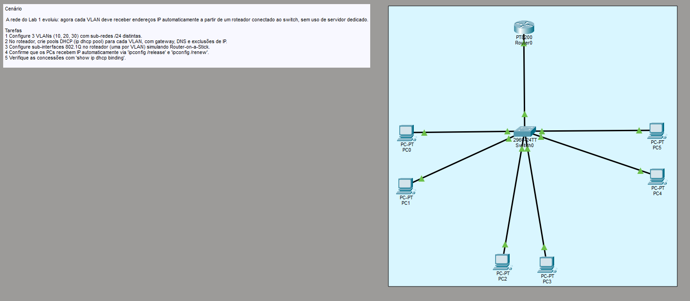
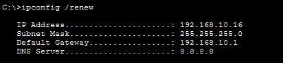
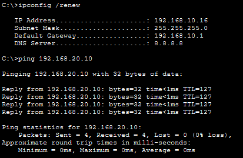

# LAB 2

Cenário
A rede do Lab 1 evoluiu: agora cada VLAN deve receber endereços IP automaticamente a partir de
um roteador conectado ao switch, sem uso de servidor dedicado.

Tarefas:
1 Configure 3 VLANs (10, 20, 30) com sub-redes /24 distintas.
2 No roteador, crie pools DHCP (ip dhcp pool) para cada VLAN, com gateway, DNS e exclusões de
IP.
3 Configure sub-interfaces 802.1Q no roteador (uma por VLAN) simulando Router-on-a-Stick.
4 Confirme que os PCs recebem IP automaticamente via 'ipconfig /release' e 'ipconfig /renew'.
5 Verifique as concessões com 'show ip dhcp binding'.

Topologia: 



Topologia evoluída do LAB 1; dessa vez, existe um roteador presente nela. Com ele, podemos configurar uma pool de DHCP para que os computadores recebam endereços automaticamente.

Neste cenário, a porta GigabitEthernet0/0/0 do Router0 está com subinterfaces, simulando Router-on-a-Stick.

Na interface GigabitEthernet0/0/0.1, está a vlan 10. Na GigabitEthernet0/0/0.2, está a vlan 20. Na GigabitEthernet0/0/0.3, está a vlan 30.

Podemos colocar mais de uma VLAN em um único link transformando a porta em uma porta trunk.

No Switch: `switchport mode trunk` e `switchport trunk allowed vlan 10,20,30`

No Router (em cada subinterface): `encapsulation dot1Q <VLAN TAG ID>`

A partir daí, no roteador, para que haja *roteamento*, definimos o IP estático de cada interface como o gateway, que será utilizado para encaminhar os pacotes entre redes distintas.

Ainda no Router, definimos uma pool de DHCP para atribuição automática de endereços utilizando o comando `ip dhcp pool <NOME DA POOL>`

Dentro da config da pool do DHCP, definimos a rede na qual queremos que a pool atue, o gateway padrão a ser atribuído e o servidor DNS padrão. 

Comandos: 

`network <IP IDENTIFICADOR DA REDE> <MÁSCARA>
default-router <GATEWAY>
dns-server <IP DO SERVIDOR DNS>` 

Exemplo utilizado na topologia:

`ip dhcp pool ADM
network 192.168.10.0 255.255.255.0
default-router 192.168.10.1
dns-server 8.8.8.8`

Ainda podemos definir quais endereços serão utilizados para hosts e quais estão reservados e não devem ser atribuídos pelo DHCP. Para isso, utilizamos o comando:

`ip dhcp excluded-address <IP INICIAL> <IP FINAL>`

Pronto! Agora é só configurar cada PC para receber configurações de rede pelo DHCP e dar um `ipconfig /release` e `ipconfig /renew` para ter o endereço atribuído.



Nesta rede, coloquei como excluded-address os hosts 192.168.10.2 até o 192.168.10.15, por isso o endpoint recebeu 192.168.10.16.

Graças ao gateway definido e o upgrade da camada de enlace para a camada de rede, também conseguimos nos comunicar com hosts de outras VLANs!



Abaixo, temos a tabela de atribuições DHCP aos hosts (`show ip dhcp binding`):

```python
IP address       Client-ID/              Lease expiration        Type
                 Hardware address
192.168.10.16    0002.4AE7.EDB3           --                     Automatic
192.168.10.17    0000.0C55.7687           --                     Automatic
192.168.20.10    0060.7076.5850           --                     Automatic
192.168.20.11    000D.BDA3.0128           --                     Automatic
192.168.30.20    0005.5EAD.D292           --                     Automatic
192.168.30.21    0005.5E6D.0E3E           --                     Automatic
```

E abaixo, temos as configurações de DHCP realizadas:

```python
ip dhcp excluded-address 192.168.10.2 192.168.10.15
ip dhcp excluded-address 192.168.20.2 192.168.20.9
ip dhcp excluded-address 192.168.30.2 192.168.30.19
!
ip dhcp pool ADM
 network 192.168.10.0 255.255.255.0
 default-router 192.168.10.1
 dns-server 8.8.8.8
ip dhcp pool VENDAS
 network 192.168.20.0 255.255.255.0
 default-router 192.168.20.1
 dns-server 8.8.8.8
ip dhcp pool TI
 network 192.168.30.0 255.255.255.0
 default-router 192.168.30.1
 dns-server 8.8.8.8
```