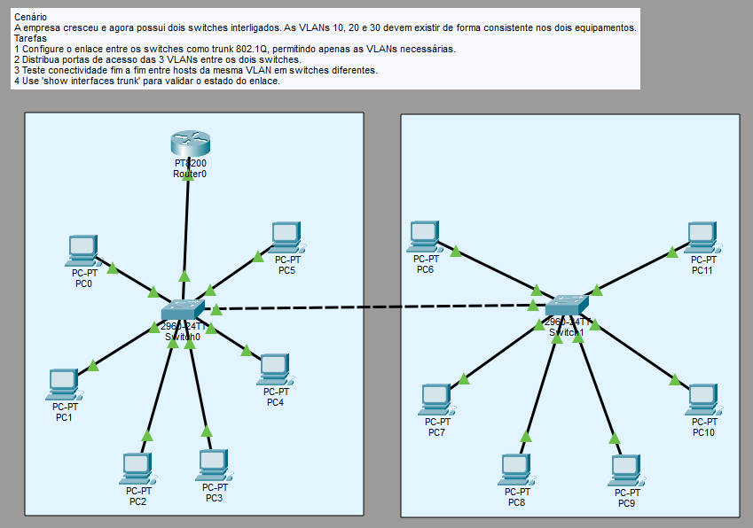
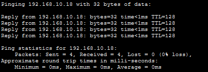
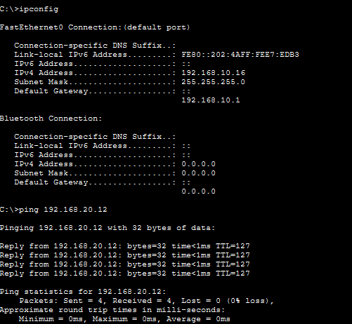

# LAB 3

Cenário
A empresa cresceu e agora possui dois switches interligados. As VLANs 10, 20 e 30 devem existir
de forma consistente nos dois equipamentos.

Tarefas
1 Configure o enlace entre os switches como trunk 802.1Q, permitindo apenas as VLANs necessárias.
2 Distribua portas de acesso das 3 VLANs entre os dois switches.
3 Teste conectividade fim a fim entre hosts da mesma VLAN em switches diferentes.
4 Use 'show interfaces trunk' para validar o estado do enlace.

Topologia: 



Evoluindo ainda mais um pouco do LAB 2, agora temos um outro switch (vamos dizer que ele conecta PCs de uma outra sala no mesmo edifício).

Para que os PCs desse segundo switch também recebam configurações pelo DHCP, precisamos de um enlace entre os dois switches. Para isso, fazemos uma porta trunk que passa de um pro outro, carregando no link as VLANs que quisermos. 

Neste caso, passei as VLANs 10, 20 e 30 no trunk.

Tá, mas como é feita a atribuição de endereço?
Muito simples, um processo abreviado como DORA: Discover, Offer, Request e Acknowledge.

Quando configuramos um PC como DHCP, ele faz um pedido em broadcast de DHCP Discover, pedindo por um endereço. O Switch manda esse pedido em broadcast pelo trunk com a VLAN do computador taggeada pelo trunk até o Switch conectado ao Router. O Router então recebe o frame na porta da interface da VLAN taggeada (vamos supor que foi a VLAN 10) e faz a mágica do DHCP (não entrarei em detalhes sobre as outras fases porque o que importa é o caminho que o frame fez). 

Dessa forma temos mais uma interconexão de dispositivos! Podemos ver que, mesmo em salas diferentes, dispositivos que fazem parte da mesma VLAN ainda se comunicam!
Abaixo, vemos um PC da Sala 1 (192.168.10.16) se comunicando com um PC da Sala 2 (192.168.10.18):



Da mesma forma, também conseguimos fazer com que dispositivos de VLANS diferentes e salas diferentes também se comuniquem!
Abaixo:



Aqui, agora, vemos a config do Switch 1 das portas trunk. A porta Gig0/1 está indo para o Router, enquanto a porta Gig0/2 está indo para o Switch da outra sala!
(Podemos ver isso através do comando `show interfaces trunk` no modo EXEC do Switch 1)

```python
Port        Mode         Encapsulation  Status        Native vlan
Gig0/1      on           802.1q         trunking      1
Gig0/2      on           802.1q         trunking      1

Port        Vlans allowed on trunk
Gig0/1      10,20,30
Gig0/2      10,20,30
```