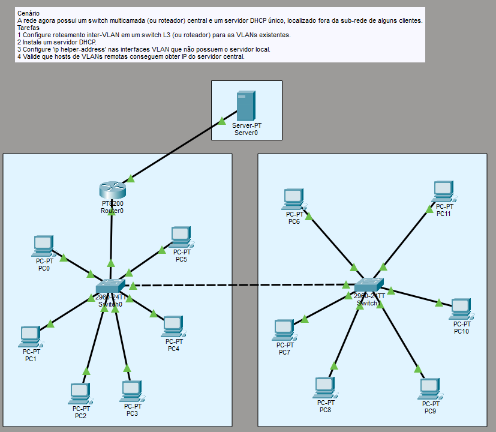
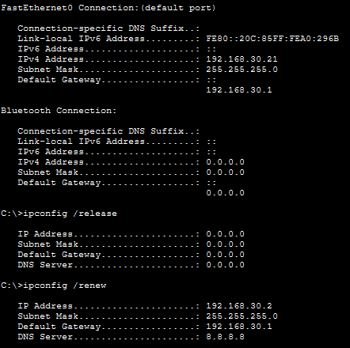

# LAB 4

Cenário
A rede agora possui um switch multicamada (ou roteador) central e um servidor DHCP único,
localizado fora da sub-rede de alguns clientes.
Tarefas
1 Configure roteamento inter-VLAN em um switch L3 (ou roteador) para as VLANs existentes.
2 Instale um servidor DHCP.
3 Configure 'ip helper-address' nas interfaces VLAN que não possuem o servidor local.
4 Valide que hosts de VLANs remotas conseguem obter IP do servidor central.

Topologia:



Uma evolução simples, mas que faz diferença.
Antes, era o próprio roteador que servia como um servidor DHCP. Agora, temos um servidor dedicado que atua nessa frente, utilizando um serviço próprio de DHCP.

Para fins didáticos, tirei todas as configurações de DHCP do roteador e utilizei apenas o servidor para isso. 

Para entender melhor também a conversão de broadcast em unicast pelo comando `ip helper-address` , deixei o servidor fora de ambas as redes. Assim, todas as VLANs tem seus DHCP Discover passando pelo roteador e indo ao servidor DHCP e nenhuma dependendo apenas do broadcast (para fins didáticos). 

```python
interface GigabitEthernet0/0/0.1
 encapsulation dot1Q 10
 ip address 192.168.10.1 255.255.255.0
 ip helper-address 10.0.0.1
```

Acima está a configuração da interface da VLAN 10 no Router0. Nela, conseguimos ver o comando ip helper-address apontando para o servidor DHCP em uma rede diferente. 

Como roteadores normalmente não comportam broadcast, o DHCP Discover foi convertido em unicast diretamente ao Servidor DHCP, que tinha a interface do Router como gateway, devolvendo a DHCP Offer e dando continuidade ao protocolo.

Nesse caso, bastou utilizar um `ipconfig /release` seguido de um `ipconfig /renew` e os PCs receberam seus IPs novos sem problemas.



### Por quê utilizar um Servidor DHCP em vez de utilizar o Router direto?

Simples, a depender da demanda, o Router fica extremamente sobrecarregado. Ele já tem que lidar com roteamento de pacotes, se precisar lidar com DHCP também, o processador frita e os serviços podem ficar lentos!