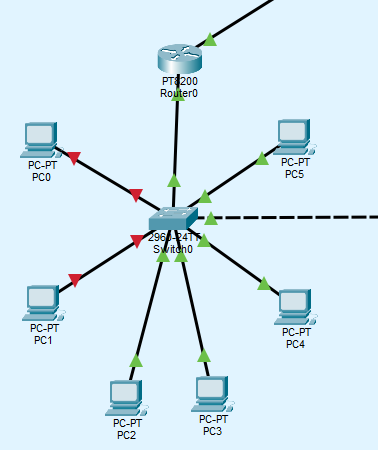
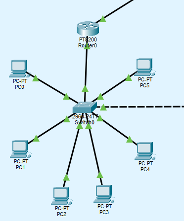

# LAB 5

**Cenário**
A área de TI quer impedir que usuários conectem switches ou notebooks não autorizados nas
tomadas de rede dos setores administrativos.

**Tarefas**
1 Ative port security nas portas de acesso dos PCs.
2 Limite o número máximo de endereços MAC aprendidos por porta a 1 (ou 2, conforme o cenário).
3 Configure o modo 'sticky' para aprendizado automático do MAC autorizado.
4 Defina a violação como 'shutdown' e simule uma violação conectando outro dispositivo.
5 Verifique o estado da porta com 'show port-security interface' e restaure a porta violada.

A topologia continua a mesma do LAB 4, a única coisa que mudou foram as configurações dos Switches. Dessa vez, coloquei um pouco de segurança no lab pra simular controle de acesso e segurança de portas.

Primeiro, apliquei uma configuração de senha ao modo EXEC dos Switches. Pude fazer isso através do comando `enable secret <SENHA>`  e coloquei a senha como “cisco” pra testar. 

Além desse, temos comandos como `enable password <SENHA>` , mas a senha fica guardada como plaintext e é fácil de descobrir.

Ainda podemos encriptar essa senha com `service password-encryption`, mas utiliza uma criptografia fraca atualmente, enquanto o `enable secret` utiliza criptografia MD5 por padrão e SHA256 em equipamentos mais recentes.

```python
Switch>en
Password: 
```

```python
# Senha criptografada
enable secret 5 $1$mERr$g.P4wjaNbSObrQl3FMhC30 
```

Depois disso, adicionei às portas dos Switches um pouco de port-security.

Port-security, como o nome bem sugere, é uma configuração que deve ser aplicada na própriaa interface e está relacionada ao aprendizado de MACs da rede.

Utiliza-se `switchport port-security` para habilitar o módulo;
`switchport port-security maximum 1` para definir o número máximo de endereços MAC aprendidos por porta;
`switchport port-security violation shutdown` (padrão) para definir a ação a ser tomada caso a regra de segurança seja violada;
`switchport port-security mac-address sticky` para que os MAC aprendidos não sejam apagados da memória do Switch, ao contrário do `dynamic` .

Para testar a funcionalidade, troquei as portas do PC0 e do PC1 depois do switch ter aprendido os MACs de cada um. Este foi o resultado:



```python

%PORT_SECURITY-2-PSECURE_VIOLATION: Security violation occurred, caused by MAC address 0002.4AE7.EDB3 on port FastEthernet0/2.
```

Como podemos observar, os dois PCs derrubaram as respectivas interfaces por não terem o MAC aprendido pela porta. 

Para resolver esta questão (não da forma mais adequada em um ambiente corporativo) podemos limpar os MACs aprendidos da tabela de MACs do switch utilizando o comando `clear port-security sticky` no modo EXEC do Switch e dando `shutdown` e `no shutdown` nas interfaces.

