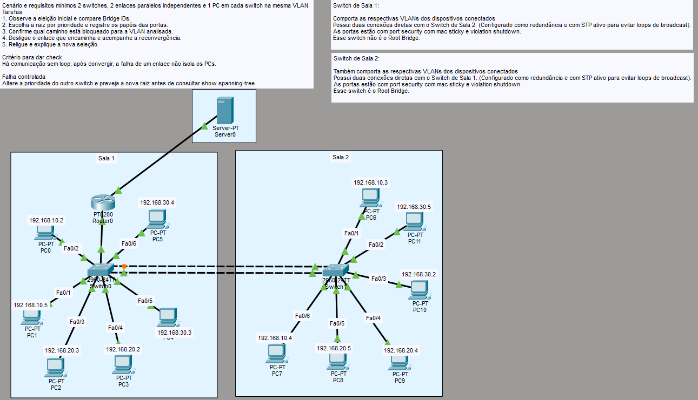
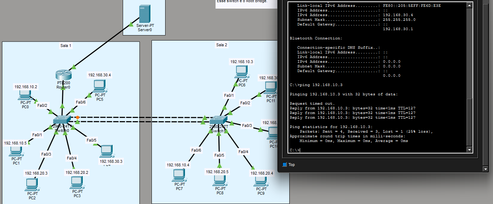
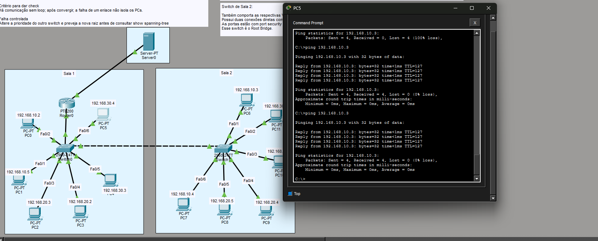
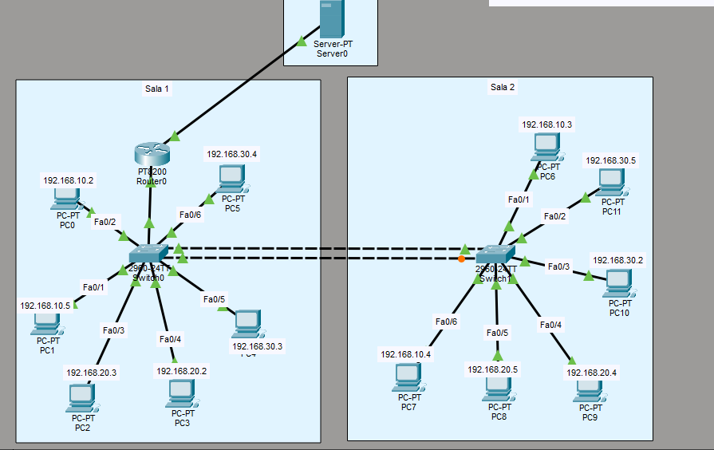

# LAB 6

Cenário e requisitos mínimos
2 switches, 2 enlaces paralelos independentes e 1 PC em cada switch na mesma VLAN.
Tarefas

1. Observe a eleição inicial e compare Bridge IDs.
2. Escolha a raiz por prioridade e registre os papéis das portas.
3. Confirme qual caminho está bloqueado para a VLAN analisada.
4. Desligue o enlace que encaminha e acompanhe a reconvergência.
5. Religue e explique a nova seleção.

**Critério para dar check**
Há comunicação sem loop; após convergir, a falha de um enlace não isola os PCs.

**Falha controlada**
Altere a prioridade do outro switch e preveja a nova raiz antes de consultar show spanning-tree

Lab feito pra testar a configuração de STP básico, mas aproveitei pra fazer uma sessão de rotulação também. Deixar hosts e portas mais indicados de uma forma que não fique confuso no futuro. (Deixei roteadores, servidores e switches de fora ainda). 

Topologia:

Nessa topologia, temos duas conexões entre os switches das salas. 

Uma delas está bloqueada para evitar o que chama-se de Broadcast Loop e broadcast storm.

Como a camada de enlace lida bastante com broadcasts, temos a possibilidade de loops dentro da rede, a deixando sobrecarregada e superestimulada.

Um dos Switches é definido como Root Bridge através de alguns critérios de prioridade. Dessa forma, o STP fica mais controlado e pode-se decidir melhor qual porta deve ficar bloqueada para que evitemos loops (não entrarei em detalhes técnicos de eleição de portas Root Port e Designated Port nesse lab).

Como o princípio da coisa é ter uma redundância de links, mesmo que um enlace se torne inutilizável, o outro é desbloqueado através da convergência do STP.

Abaixo, temos o PC5 pingando o PC6 com os dois links ativos.

Agora, vou remover um dos links entre os switches (o que não está com a porta bloqueada) e vou fazer o ping novamente.

Percebe-se que, mesmo com a remoção de um dos links, o STP já convergiu e fez com que não perdessemos a conexão.

Agora, propositalmente, elegi o SW1 como Root Bridge desse contexto, settando a prioridade dele como 4096 (tem que ser em múltiplos de 4096).

Como o SW2 não é mais root bridge, a porta dele deve ser a que fica bloqueada pelo STP (nesse contexto).

Abaixo:

